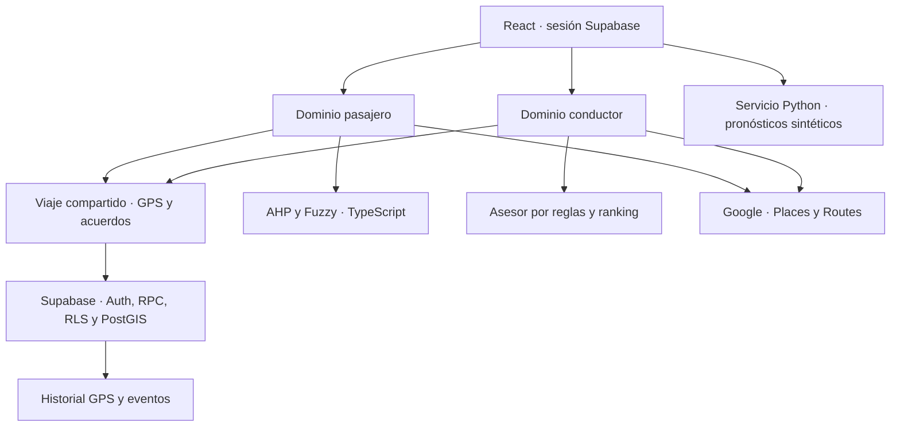
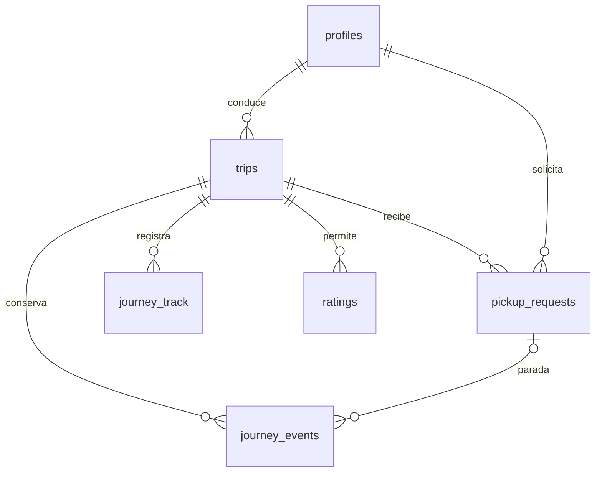

# Arquitectura de Vamo

La separación por rol es lógica y de autorización, dentro de una SPA React/TypeScript. Un usuario puede ser pasajero y conductor, pero el acceso a cada viaje se decide por su participación concreta. La interfaz conserva azul marino, marfil y ámbar.

## Responsabilidades

| Capa | Responsabilidad | Autoridad |
| --- | --- | --- |
| `features/auth` | Sesión, DNI, perfiles, roles, verificación de demostración | Auth y RLS validan identidad y acceso |
| `features/passenger` | Preferencias, AHP, Fuzzy y ranking de opciones | Recomienda; nunca acepta ni cambia aportes |
| `features/driver` | Asesor de solicitudes y lista de reputación | Recomienda; aceptación manual |
| `features/journey` | Búsqueda geográfica, acuerdo, estado, GPS, paradas y ETA | RPC, triggers y RLS validan transiciones y capacidad |
| `features/history` | Mapa de planeado/observado, cortes y eventos | RPC recorta historial según rol |
| `features/ratings` | Calificación mutua al completar el viaje | Policy de contraparte, unicidad y prohibición de edición |
| `recommendation-service` | Modelos sintéticos y material académico conservado | No confundir simulaciones con observaciones reales |

## Datos operativos e históricos

- `profiles`: DNI y apellidos privados, roles, verificación y estado de revisión. `public_profiles` revela solo datos permitidos.
- `trips`: conductor, vehículo, polilínea original, horario, duración, aporte por asiento, capacidad y estado.
- `pickup_requests`: extremos solicitados, paradas proyectadas sobre la ruta, fracciones, aporte congelado, estado y fase del pasajero.
- `journey_presence`: última lectura temporal por participante. Lecturas de más de 30 s dejan de ser válidas; se limpian al finalizar o completar participación.
- `journey_track`: muestras del **conductor**, con timestamp del dispositivo, recepción del servidor y precisión. Se conservan al borrar presencia; no contiene recorridos GPS personales de pasajeros.
- `journey_events`: inicio, recojo, bajada y cierre. Los tiempos son del servidor. En paradas, la posición corresponde a la lectura reciente del vehículo al confirmar; el punto acordado permanece en la solicitud.
- `ratings`: una reseña por contraparte y viaje. El ranking nuevo considera reseñas recibidas como conductor, no su promedio mixto de perfil.

## Límites de confianza

El navegador contiene solo claves públicas y puede ser manipulado. La geolocalización valida edad/precisión de la lectura, pero no acredita que el hardware no haya falseado GPS. Las RPC fijan precios y verifican participación. El cliente no escribe directamente en tablas históricas ni obtiene las funciones base internas.

El conductor ve participantes y solicitudes de su viaje. Un pasajero ve su acuerdo y ubicación del conductor mientras su participación está activa. Al finalizar, solo recibe las muestras entre su recojo y bajada; no recibe la ubicación de eventos de inicio/fin fuera de su tramo. Si no hubo recojo confirmado no se le entrega trayectoria. Un tercero o usuario anónimo no tiene acceso al historial.

No hay una política de borrado programado de historial implementada en esta entrega. Antes de un piloto real deben definirse plazo de conservación, canal de eliminación y aviso de privacidad. Los registros actuales son para el proyecto y no se exportan a repositorios ni se convierten en dataset público.

## Preservación

Se tomó el árbol completo de la última rama, no solo `main`. El nuevo Git empieza en un primer commit independiente. No se arrastran `.env.local`, tokens CLI, cachés, `node_modules`, datos reales ni historial Git anterior. El repositorio anterior permanece intacto. El contexto antiguo se conserva en documentos identificados como históricos.
