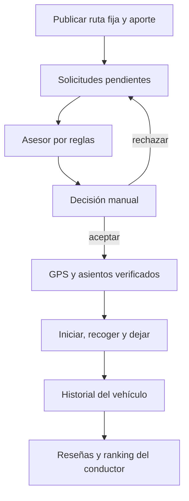

# Arquitectura del conductor

## Objetivo y flujo

El conductor comparte asientos en un trayecto previsto. Mantiene su trazado y decide personalmente con quién comparte el viaje.

1. Cuenta verificada con rol conductor y vehículo registrado. Publica origen/destino, polilínea calculada por Maps, horario, asientos y aporte de ruta completa.
2. Se abre el viaje y activa GPS. Recibe solicitudes pendientes con paradas y aporte congelado.
3. `DriverAdvisor` aplica reglas independientes de AHP/Fuzzy del pasajero. Descarta datos incompletos, GPS vencido, paradas invertidas y recojos superados. Ordena por mayor aporte o por recojo más próximo a lo largo de la ruta.
4. Propone hasta el mínimo de plazas disponibles y presupuesto de nuevas paradas: 30 s por recojo + 30 s por bajada = 1 min por solicitud. Resume número de pasajeros, aporte adicional y minutos extra estimados. El presupuesto no incluye detenciones de reservas anteriores.
5. Acepta/rechaza una por una. El servidor revalida GPS y plazas, también frente a concurrencia. El asesor no ejecuta aceptaciones masivas ni decisiones automáticas.
6. Inicia solo con GPS reciente de todos los confirmados. Ve al vehículo, pasajeros y paradas. Confirma recojo y luego bajada a menos de 200 m de la parada acordada.
7. Al terminar consulta el recorrido completo, muestras, cortes de señal y paradas. Puede valorar a pasajeros cuya bajada se confirmó. Las reseñas recibidas como conductor alimentan el ranking público para usuarios verificados.

## Contratos

| Operación | Autoridad / límite |
| --- | --- |
| Crear `trips` | Solo propietario conductor con vehículo y revisión permitida |
| `journey_room` | Solo propietario obtiene todas sus solicitudes y disponibilidad |
| Advisor local | Datos operativos, objetivo y presupuesto; sugiere sin modificar filas |
| Responder `pickup_requests` | Policy reserva aceptación al conductor del viaje |
| Iniciar/finalizar | Propietario; triggers validan estado y GPS al iniciar |
| `journey_stage` | Propietario en curso, secuencia waiting → onboard → completed y GPS cerca |
| `journey_history` | Todo el vehículo y sus eventos, disponible al finalizar/cancelar |
| `driver_leaderboard` | Agregados; no revela DNI, comentarios privados ni localizaciones |

Esta versión reserva cada asiento durante todo el viaje, no lo reasigna tras una bajada. Por eso el asesor no usa reutilización por tramos. No es un problema de optimización vial ni promete solución global de tráfico: es un apoyo determinista, explicable y compatible con las restricciones actuales.
