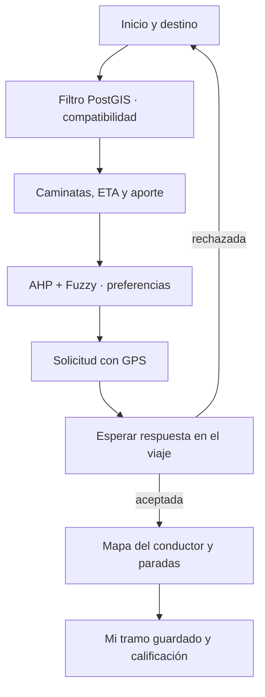

# Arquitectura del pasajero

## Objetivo y flujo

El pasajero encuentra un asiento en una ruta que el conductor ya recorrerá. Declara inicio/destino; no exige que el conductor llegue a su puerta ni cambie su camino.

1. Registro con DNI y autenticación. El backend exige verificación y estado de revisión permitido para solicitar.
2. `LocationSearch` consulta Places y ofrece selección en mapa. `journey_options` valida Lima, corredor de 150 m, sentido de ambos puntos, plazas y disponibilidad.
3. Cada opción contiene paradas sobre la ruta, importe proporcional y metadatos del conductor. Routes consulta las caminatas. La ETA añade duración restante, espera y caminata final.
4. `PassengerPreferences` permite elegir un perfil o editar seis comparaciones de cuatro criterios. `decision.ts` calcula pesos AHP y CR, aplica Mamdani a las valoraciones, normaliza métricas y ordena alternativas que tienen tiempos válidos y recojo alcanzable.
5. El pasajero elige. `request_journey` solicita GPS, valida precio esperado y congela el acuerdo. Se abre `/viaje/:id` con solicitud pendiente.
6. La pantalla avanza automáticamente según la respuesta y el estado del conductor. Muestra GPS, paradas y tiempos sin cambiar de pestaña. El pasajero no puede aceptar ni confirmar paradas.
7. Al cerrar, `journey_history` muestra su tramo registrado y eventos; puede calificar al conductor si hay bajada confirmada y viaje finalizado.

## Contratos y permisos

| Operación | Entrada | Resultado / control |
| --- | --- | --- |
| `journey_options` | Dos coordenadas | Hasta 10 rutas geográficamente compatibles; reputación agregada |
| AHP/Fuzzy local | Tiempos, caminatas, aporte y reseñas | Puntaje relativo explicable, no reserva |
| `request_journey` | Viaje, extremos, precio esperado, GPS fresco | Solicitud pendiente o error transaccional |
| `journey_gps` | Solo identidad de sesión y viaje propio | Última lectura temporal; no comparte GPS antes de aceptación |
| `journey_room` | Viaje en que participa | Solo su solicitud y datos del conductor autorizados |
| `journey_history` | Viaje terminal aceptado | Su tramo a bordo; sin paradas de otros pasajeros |
| `ratings` | Contraparte, estrellas y comentario | Solo el conductor de ese viaje completado |

Los valores ausentes no se inventan: sin caminata o ETA no se recomienda una opción como completa. El orden AHP es relativo al conjunto disponible; incorporar o retirar alternativas puede cambiarlo. Un CR inconsistente conserva el orden geográfico y pide ajustar preferencias.
